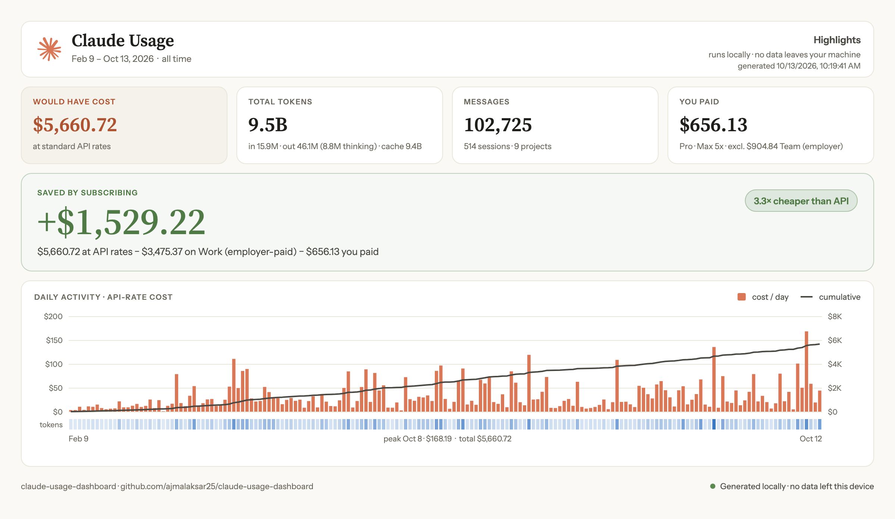
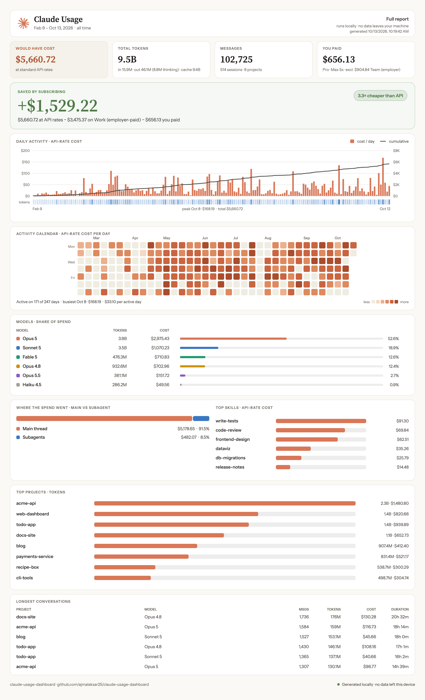

# Claude Usage Dashboard

> A local, one-command dashboard that shows how much you've actually saved (or not) by paying for Claude subscriptions instead of API list prices for the same usage. Runs entirely on your machine — no data leaves your device.

It indexes every Claude Code profile on the machine (`~/.claude`, `~/.claude-work`, …) plus Codex CLI and Pi sessions, prices each message at its model's API list rate, and compares the total with what you actually paid.



## Quick start

```bash
git clone https://github.com/ajmalaksar25/claude-usage-dashboard.git
cd claude-usage-dashboard
./start.sh        # macOS / Linux   (Windows: start.bat)
```

The script creates a virtualenv, indexes your history and opens `http://127.0.0.1:8765`. Requires Python 3.10+. The first run takes about ten seconds; after that only changed files are re-read, and a background watcher keeps the page current.

## What you get

- **Overview**: headline cards (would have cost, tokens, messages, you paid, saved), an accounts table showing how each account is billed, daily activity (tokens, cost by model or cost by token type), an activity heatmap, models and projects.
- **Sessions & days**: each session's title, model mix, active time, cost, subagent cost, linked PRs and branch, plus the most active days.
- **Breakdown**: where the spend went, by token type, main thread vs subagents, agent, skill, MCP server, plugin, branch, PR, entry point or effort. Also API errors and retries, and Claude Code's own cost tally next to ours.
- **Export**: Highlights and Full report PNGs in the current theme and filters.

Click an account, model, project, hour or row to filter the whole page. Chart.js and the fonts ship in `static/vendor/`, so it works offline.



## What it can and can't see

It reads local files only. None of these tools offers an API for past usage, so:

- **Claude Code deletes transcripts after 30 days** by default ([docs](https://code.claude.com/docs/en/data-usage)), so a first run sees about a month. Raise `cleanupPeriodDays` in each profile's `settings.json` (e.g. `365`) to keep more.
- **Indexed history outlives the transcript.** Tokens and cost stay in `usage.db` after the file is deleted, so let the dashboard index at least once a month and back up `usage.db`. Details such as agent, skill and branch can't be recovered for deleted transcripts; Breakdown shows that spend as "Not attributable".
- **Only this machine.** Claude.ai chats, Claude Code on the web and other computers never reach it.
- **Codex CLI** keeps its sessions with no automatic cleanup, so its history usually goes back further. Cursor and Gemini transcripts carry no token usage and are not read.
- Usage a gateway didn't report is estimated and flagged; failed requests with no usage are not counted.

## Billing

- **Receipts**: copy `billing.json.example` to `billing.json`, or click **Connect Gmail** (read-only, runs locally) to import Anthropic, OpenAI/ChatGPT, Apple and Google Play receipts with currency conversion. Manage them under **Accounts → Receipts**. Without receipts the dashboard shows only the API cost, and periods without a receipt show "unknown", not $0.
- **Per-account settings** go in `config.json` (see `config.json.example`): billing mode, `paid_by` to share one plan across accounts, and `"payer": "employer"` for a plan your employer pays. Employer-paid accounts are left out of **You paid** and **Saved by subscribing**; the savings subtitle shows the subtraction.
- **API rates** come from Anthropic's published prices, refreshed daily from [LiteLLM's price table](https://github.com/BerriAI/litellm/blob/main/model_prices_and_context_window.json) and cached in `pricing.json`. When a rate changes, stored rows are re-priced. Offline, the built-in table is used.

## Terminal CLI

```bash
python cli.py                      # headline numbers, all time
python cli.py summary -w 1w        # this week
python cli.py projects -w 1m -n 10 # top projects, last month
python cli.py models               # tokens + cost per model
python cli.py accounts             # per-account rollup
python cli.py refresh --all        # re-index, incl. tool calls
python cli.py dash --all           # launch the web dashboard
```

Filters work everywhere: `-w <window> -a <account> -p <project>`. To install it as commands: `pipx install git+https://github.com/ajmalaksar25/claude-usage-dashboard.git`, then `claude-usage` and `ccm`.

## Multiple accounts

Claude Code reads its config from `CLAUDE_CONFIG_DIR`, so separate accounts are separate directories (`~/.claude-work`, `~/.claude-personal`, …). Each `~/.claude*/projects` directory becomes an account automatically; list unusual locations in `accounts.json` (`[{"name": "work", "root": "~/.claude-work/projects"}]`).

`ccm.py` (stdlib only, macOS/Linux/Windows) sets these profiles up and links `skills/`, `agents/`, `commands/` and `rules/` from one `~/.claude-shared`. It never touches credentials, settings or history.

```bash
python ccm.py init-shared --from-profile default   # move shared resources into ~/.claude-shared
python ccm.py create work                          # new profile, prints its shell alias
python ccm.py doctor                               # audit
```

## Configuration

| | |
| --- | --- |
| `CLAUDE_USAGE_DB` / `--db` | database location (default `usage.db` next to the code) |
| `CLAUDE_USAGE_TZ` | time zone for day and hour buckets (or `timezone` in `config.json`) |
| `CUD_WATCH_INTERVAL` | watcher base interval in seconds (default `120`; backs off to `CUD_WATCH_MAX_INTERVAL`, default `900`) |
| `--no-watch` | turn the watcher off |

## Roadmap

- Per-project deep-dive view
- Export to JSON / CSV
- Cursor and Gemini CLI support (their transcripts carry no token usage today)
- Shareable summary card with PII stripped

Want to rebuild it your own way? [docs/BUILD_SPEC.md](docs/BUILD_SPEC.md) describes the behaviour for Claude Code to recreate.

## Feedback

If your numbers come out wildly different from mine, please [open an issue](https://github.com/ajmalaksar25/claude-usage-dashboard/issues). The more usage patterns it covers, the better it settles the debate.

## License

[MIT](LICENSE). Built by [Ajmal Aksar](https://www.ajmalaksar.com), a backend dev who shipped the first version in two hours after a Reddit comment hit too close to home.
